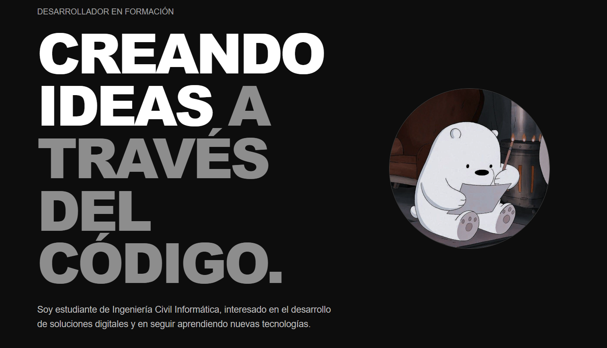
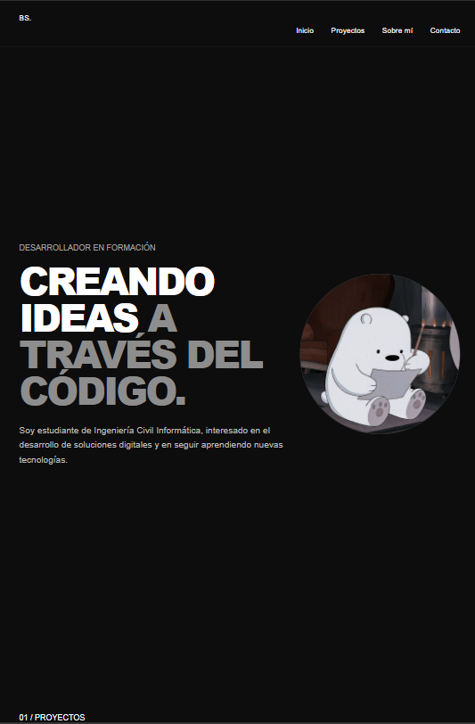
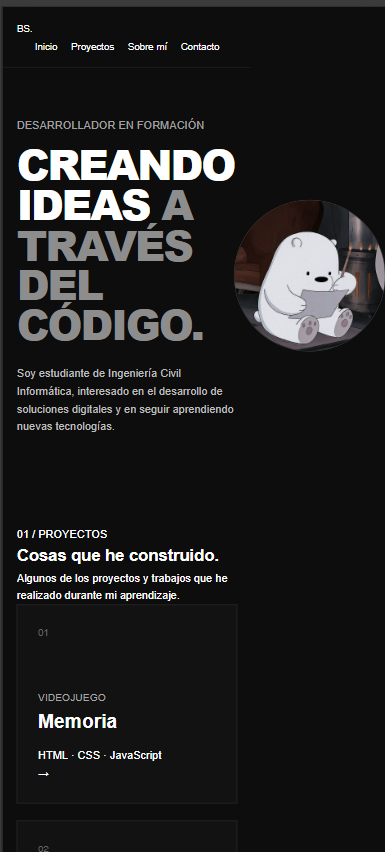
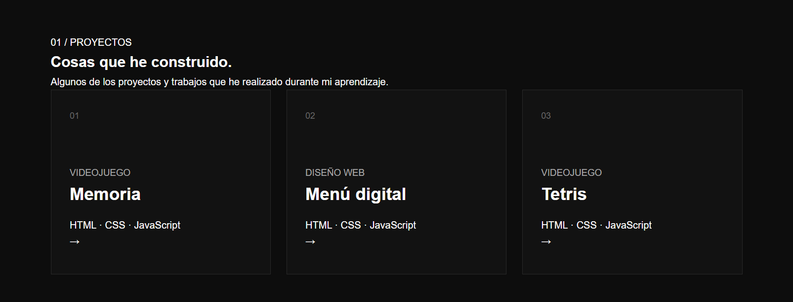

# Portafolio de Bayron Salgado

Hola Soy Bayron Salgado, estudiante de Ingeniería Civil Informática. Este es mi portafolio personal: el lugar donde me presento y muestro los proyectos que he ido construyendo durante mis estudios. Lo desarrollé como evaluación P2 de Desarrollo de Frontend (ICINF1107), y lo pensé como la primera pieza de mi portafolio profesional.

## Contenido

- [Vista general](#vista-general)
- [Para quién lo hice](#para-quién-lo-hice)
- [Capturas](#capturas)
- [Mis proyectos](#mis-proyectos)
- [Tecnologías que usé](#tecnologías-que-usé)
- [Decisiones de diseño](#decisiones-de-diseño)
- [Diseño responsivo](#diseño-responsivo)
- [Accesibilidad](#accesibilidad)
- [Estructura del proyecto](#estructura-del-proyecto)
- [Cómo abrirlo](#cómo-abrirlo)

## Vista general

En el sitio cuento quién soy, muestro una selección de mis proyectos y dejo una sección de contacto. Lo construí como un sitio estático con HTML, CSS y JavaScript, sin frameworks ni pasos de compilación, porque quería entender bien las bases antes de usar herramientas más grandes.

## Para quién lo hice

Pensé este portafolio para **reclutadores y docentes** que lo revisan en pocos minutos. Me puse en su lugar y entendí que necesitan:

1. Saber rápido quién soy y qué estudio, por eso lo pongo en la primera pantalla.
2. Ver evidencia real de lo que sé hacer, por eso cada proyecto se puede abrir y probar.
3. Poder contactarme fácilmente, por eso incluí un formulario.

Mi objetivo es que quien entre entienda mi perfil en segundos y pueda comprobarlo con mis trabajos.

## Capturas

| Escritorio | Tablet | Móvil |
|---|---|---|
|  |  |  |



## Mis proyectos

### Memoria

Un juego de encontrar parejas de cartas. Las cartas se barajan al comenzar y el juego cuenta mis movimientos y el tiempo. También agregué la opción de empezar una nueva partida.

- [Abrir el juego](proyectos/memoria/index.html)
- Tecnologías: HTML, CSS y JavaScript.

### Menú digital

Una página de muestra para una cafetería ficticia que inventé, “Miga y Miel”. Presenta una carta de productos con filtros por categoría: café y bebidas, brunch y opciones dulces.

- [Abrir el menú](proyectos/menu/index.html)
- Tecnologías: HTML, CSS y JavaScript.

### Tetris

Mi versión sencilla del clásico juego de bloques, con puntuación, eliminación de líneas y reinicio.

- [Abrir Tetris](proyectos/tetris/index.html)
- Controles: **A/D** para mover, **S** para bajar, **W** para girar y **R** para reiniciar.
- Tecnologías: HTML, CSS, JavaScript y Canvas.

## Tecnologías que usé

- HTML5 con estructura semántica (`header`, `nav`, `main`, `section`, `footer`)
- CSS3 en un archivo externo (Flexbox, Grid, `clamp()` y media queries)
- JavaScript sin frameworks
- Canvas 2D para dibujar el tablero de Tetris

## Decisiones de diseño

- **Todo en una sola página:** ordené las secciones en inicio, proyectos, sobre mí y contacto, porque es el orden en que creo que alguien querrá recorrerlas. El menú de navegación permite saltar directo a cada una.
- **Tema oscuro con tonos de gris:** elegí un estilo sobrio y limpio. La jerarquía la logré con el tono: blanco para lo más importante y grises para lo secundario.
- **Título grande al inicio:** quise que mi nombre fuera lo primero que se lee. Usé `clamp()` para que el tamaño se ajuste a cada pantalla sin romperse.
- **Proyectos como tarjetas numeradas:** hice que cada tarjeta sea un enlace completo y que se levante un poco al pasar el mouse, para que se note que se puede abrir.
- **Ancho máximo de 1200 px y textos angostos:** lo hice para que las líneas no queden demasiado largas y se lea cómodo.
- **Formulario de contacto:** preferí dar una vía directa para escribirme, sin depender de que la persona abra su correo.
- **Página propia para cada proyecto:** con un enlace de "volver", para que cada trabajo tenga su espacio.

## Diseño responsivo

Escribí mi CSS partiendo desde escritorio y agregué dos puntos de quiebre, que dan como resultado tres rangos de pantalla:

| Rango | Punto de quiebre | Qué cambia |
|---|---|---|
| Escritorio | base (más de 900 px) | 3 columnas de proyectos y contacto en 2 columnas |
| Tablet | `max-width: 900px` | 2 columnas de proyectos, contacto en 1 columna, márgenes y círculo de imagen más pequeños |
| Móvil | `max-width: 600px` | 1 columna, la presentación se apila, el menú se centra y baja de línea, y las tipografías se reducen |

## Accesibilidad

Estas son las consideraciones que apliqué (basadas en WCAG):

- **Estructura semántica y encabezados jerárquicos:** uso un `h1` por página, seguido de `h2` y `h3` sin saltarme niveles.
- **Foco visible con teclado:** les puse un contorno claro a los enlaces, tarjetas, campos y botones cuando reciben el foco.
- **Formulario con etiquetas:** cada campo tiene su `label`.
- **Texto alternativo:** agregué `alt` descriptivo a las imágenes.
- **Contraste:** el texto principal es blanco (`#ffffff`) sobre `#0d0d0d`, y el texto secundario usa grises claros. Revisé los pares de colores con el Contrast Checker de WebAIM y todos cumplen el mínimo AA de 4,5:1.
- **Navegación por teclado:** probé que todo lo interactivo se pueda alcanzar con la tecla Tab.

## Estructura del proyecto

```text
.
├── index.html
├── README.md
├── assets/
│   ├── css/
│   │   └── style.css
│   └── img/
│       ├── polar.jpeg
│       └── capturas/
└── proyectos/
    ├── memoria/
    │   ├── index.html
    │   ├── script.js
    │   └── style.css
    ├── menu/
    │   ├── index.html
    │   ├── script.js
    │   └── style.css
    └── tetris/
        ├── index.html
        ├── script.js
        └── style.css
```

## Cómo abrirlo

No necesitas instalar nada. Clona o descarga el repositorio y abre `index.html` en tu navegador.

Si prefieres levantar un servidor local, puedes hacerlo desde la carpeta del proyecto. Por ejemplo, con Python instalado:

```bash
python -m http.server 8000
```

Después visita <http://localhost:8000>.

## Lo que aprendí y lo que mejoraría

**Lo que aprendí:** a construir una página personal desde cero. Lo más importante fue aprender a enlazar varias páginas HTML entre sí: cada proyecto vive en su propia carpeta y se abre desde el portafolio en la misma pestaña, con un enlace para volver.

**Lo que mejoraría:** el diseño. Los colores y el estilo son bastante simples y poco llamativos. Además, si el portafolio sigue creciendo, crearía una página aparte solo para los proyectos, con una lista donde cada uno tenga una explicación breve y un botón que lleve directamente a él.